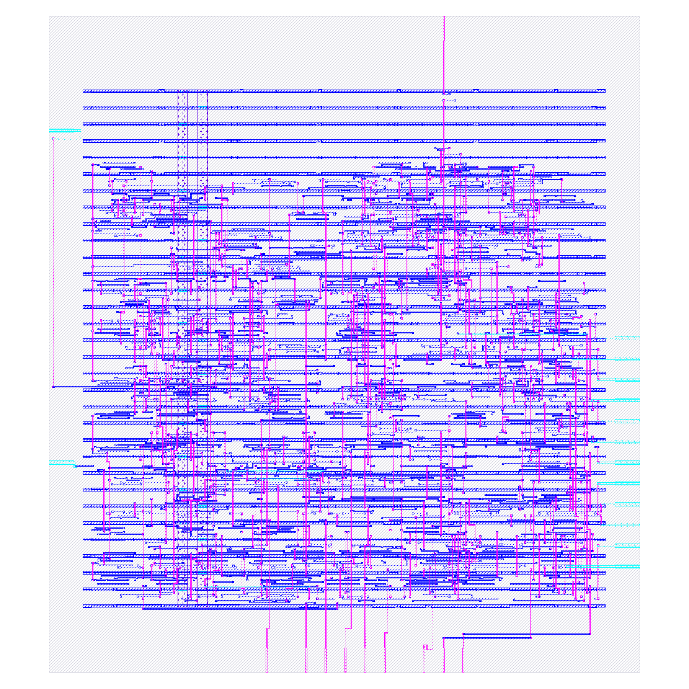
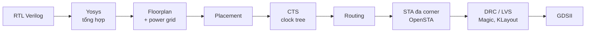
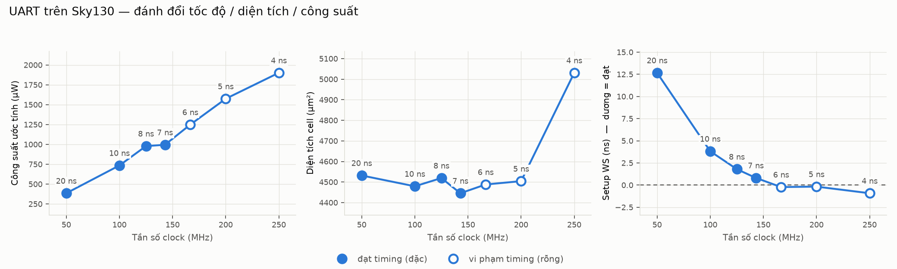

# UART 8N1 — từ RTL đến GDSII với OpenLane (Sky130)

Dự án cá nhân đưa một lõi UART (TX + RX) đi hết flow thiết kế vật lý: **RTL → tổng hợp → floorplan → placement → CTS → routing → STA → DRC/LVS**, dùng toàn bộ công cụ mã nguồn mở (Yosys, OpenROAD, OpenSTA, Magic, KLayout) trên PDK **SkyWater Sky130A**.

Mục đích chính là hiểu các bước của Physical Design và đọc được kết quả của chúng (timing, diện tích, công suất), chứ không phải tạo ra một UART mới.



## 1. Mục tiêu

- Viết RTL UART đơn giản, kiểm chứng bằng simulation.
- Chạy flow RTL→GDS hoàn chỉnh và hiểu từng giai đoạn làm gì.
- Viết ràng buộc thời gian (SDC) đầy đủ và thấy ràng buộc ảnh hưởng đến kết quả ra sao.
- Quét chu kỳ clock để lập bảng đánh đổi giữa tốc độ, diện tích và công suất.

## 2. Thiết kế

| Module | Chức năng |
|---|---|
| `uart_tx` | Phát khung 8N1: bit start, 8 bit dữ liệu (LSB trước), bit stop. FSM 4 trạng thái IDLE/START/DATA/STOP. |
| `uart_rx` | Thu khung 8N1. Có bộ đồng bộ 2 flip-flop cho tín hiệu bất đồng bộ `rx`, lấy mẫu giữa bit, kiểm tra lại bit start (lọc nhiễu), báo `frame_err` nếu bit stop sai. |
| `uart` | Top-level, ghép TX và RX. |

Tham số `CLKS_PER_BIT` (mặc định 434 = 50 MHz / 115200 baud). Reset bất đồng bộ, tích cực mức thấp (`rst_n`).

## 3. Kiểm chứng RTL

Testbench `tb/tb_uart.v` nối `tx_serial` vào `rx_serial` (loopback), gửi 6 byte `0x55, 0xA3, 0x00, 0xFF, 0x7E, 0x81` và so sánh với byte nhận được. Kết quả: `ALL TESTS PASSED`.

```bash
iverilog -o sim src/*.v tb/tb_uart.v && vvp sim
gtkwave tb_uart.vcd
```

## 4. Flow RTL → GDS



Chạy bằng OpenLane 2 (Classic flow, khoảng 78 bước) trong Docker:

```bash
openlane --dockerized config.json
```

## 5. Ràng buộc thời gian (SDC)

File `constraints.sdc` mô tả cho công cụ biết môi trường mà mạch làm việc:

| Lệnh SDC | Ý nghĩa |
|---|---|
| `create_clock`, `set_clock_uncertainty`, `set_clock_transition` | Chu kỳ clock, độ nhiễu pha (jitter/skew dự phòng), độ dốc xung clock |
| `set_input_delay` / `set_output_delay` (20% chu kỳ) | Phần chu kỳ bị mạch bên ngoài chiếm ở cổng vào/ra |
| `set_driving_cell` | Cổng vào được lái bởi cell nào (ở đây `inv_2`) |
| `set_load` | Tải điện dung ở cổng ra |
| `set_max_transition`, `set_max_capacitance`, `set_max_fanout` | Giới hạn thiết kế |

## 6. Kết quả

### 6.1. Cùng một thiết kế, ba cách ràng buộc (clock 20 ns)

{{COMPARE_TABLE}}

- **WS** (worst slack) là độ dư thời gian ở đường tệ nhất; dương nghĩa là đạt. Setup xấu nhất ở corner chậm (ss, 100 °C, 1.60 V), hold xấu nhất ở corner nhanh (ff, −40 °C, 1.95 V).
- SDC v1 thiếu phần môi trường (driving cell, load, giới hạn thiết kế) nên cho kết quả lạc quan hơn thực tế.
- Giữa SDC mặc định và SDC v2, nội dung ràng buộc giống nhau nhưng diện tích và công suất vẫn lệch vài phần trăm. Mình chưa chứng minh được nguyên nhân (nghi do cách ràng buộc được đưa vào flow). Flow có tính tất định: chạy lại cùng cấu hình cho kết quả y hệt.

### 6.2. Quét chu kỳ clock

Mỗi chu kỳ chạy lại toàn bộ flow, độ trễ I/O luôn bằng 20% chu kỳ.

{{SWEEP_TABLE}}



{{FMAX_SENTENCE}}

Nhận xét:

- **Công suất** tăng gần tỉ lệ với tần số (công suất động ∝ f), khoảng 7–8 µW/MHz.
- **Diện tích** gần như không đổi khi clock còn thoải mái, rồi tăng khi công cụ phải chèn thêm buffer và nâng kích thước cell để cứu timing.
- Khi chu kỳ quá ngắn, **flow vẫn chạy xong và vẫn sinh GDS**. Phải đọc slack để biết timing có đạt hay không.

## 7. Bài học

1. **Flow chạy xong không có nghĩa là timing đạt.** Phải kiểm tra setup/hold slack ở mọi corner.
2. **SDC thiếu cho kết quả lạc quan.** Thiếu driving cell và load làm đường vào/ra nhẹ hơn thực tế.
3. **Hold và setup bị giới hạn ở hai corner khác nhau.** Không thể chỉ nhìn một corner.
4. **PPA nhạy với đầu vào.** Hai cấu hình cùng ý nghĩa có thể cho số liệu lệch vài phần trăm, nên luôn ghi rõ cấu hình khi so sánh.
5. **Công suất ở đây là ước lượng** từ STA với mặc định hoạt động của công cụ, không phải đo từ mô phỏng gate-level.

## 8. Hạn chế

- Chỉ khảo sát clock, không đổi mật độ placement, mục tiêu utilization hay cấu hình tổng hợp.
- Chưa mô phỏng gate-level sau routing.
- Mỗi điểm trong bảng sweep chỉ chạy một lần.

## 9. Chạy lại

```bash
cd ~/vlsi && source .venv/bin/activate
cd uart
openlane --dockerized config.json     # một lần chạy
bash sweep.sh                         # quét chu kỳ clock
pip install matplotlib && python3 make_report.py
```

## 10. Cấu trúc thư mục

```
src/            RTL (uart.v, uart_tx.v, uart_rx.v)
tb/             testbench loopback
constraints.sdc ràng buộc thời gian
config.json     cấu hình OpenLane
sweep.sh        quét chu kỳ clock
collect.py      gom kết quả sweep
make_report.py  vẽ biểu đồ và sinh README
results/        GDS, báo cáo và metrics đã chọn
images/         ảnh layout, waveform, biểu đồ
```
